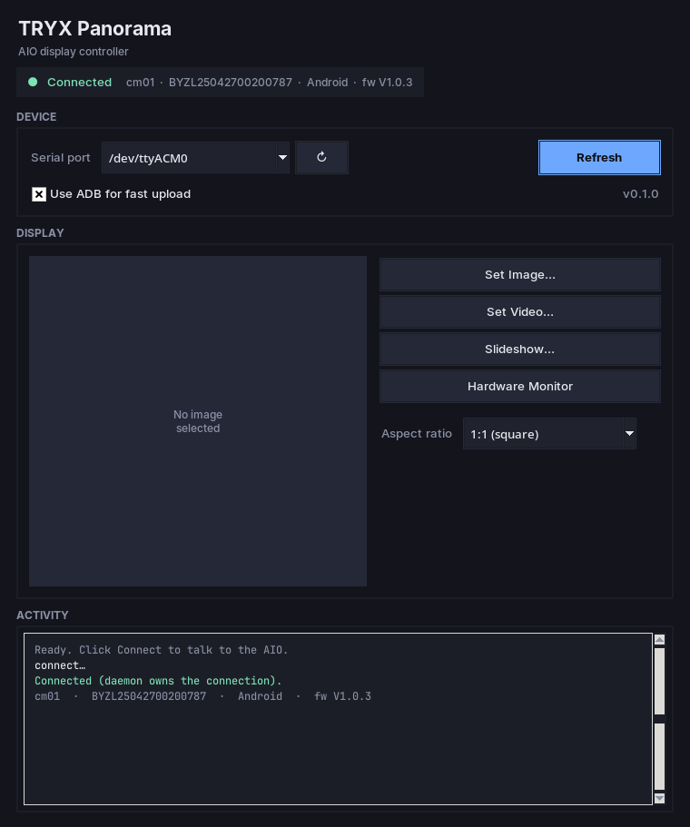

# tryxctl — control the TRYX Panorama AIO display from Linux

> ⚠️ **Disclaimer:** This is a **vibe-coded** project — written with AI
> assistance as a personal hobby project. It is not affiliated with or
> endorsed by TRYX or baiyi, is provided as-is with no warranty of any
> kind, and may break without notice. Use at your own risk.

A small Python program that changes the image/video shown on a **TRYX Panorama
240 SE** all-in-one cooler's pump-head display.

The display is actually a Rockchip Android 11 board (codename `cm01_se`, OEM
"baiyi") that enumerates on USB as `18d1:2d04` and exposes:

* a **CDC-ACM serial port** (`/dev/ttyACM0`) — control/telemetry channel, and
* an **ADB interface** — used here for fast media upload.

The official Windows app (TRYX KANALI) drives the same serial protocol; this
tool reimplements it. It was reverse-engineered from the on-device firmware
(`HomeUI.apk` / `SerialService.apk`); see
[`device_dump/PROTOCOL-NOTES.md`](device_dump/PROTOCOL-NOTES.md) and
[`device_dump/PROTOCOL.md`](device_dump/PROTOCOL.md) for the full protocol.

## Requirements

* Linux, Python ≥ 3.9
* `pyserial` (installed into the bundled venv below)
* `adb` (Android platform-tools) — optional, used for fast file upload. Falls
  back to the serial transfer protocol with `--no-adb`.
* Read/write access to `/dev/ttyACM0` (usually the `dialout` group).

## Install

```bash
cd <project-root>   # the directory containing this README
python3 -m venv .venv
.venv/bin/pip install pyserial Pillow
# optionally install the console scripts:
.venv/bin/pip install -e .
```

## GUI

There is a dark-themed desktop app (Tkinter) if you'd rather not use the
terminal:

```bash
.venv/bin/python -m tryx.gui
# or, after `pip install -e .`:
tryx-gui
```

It auto-detects `/dev/ttyACM*`, auto-connects on launch, shows device info in
a status pill, and gives you **Set Image / Set Video / Slideshow / Hardware
Monitor** buttons with a live image preview and an activity log.



## Daemon (keeps the display alive after you close the app)

The device reverts to its standby screen ~60 s after the last host message, so
the GUI/CLI delegate to a small background **daemon** that owns the serial
connection and sends a heartbeat every 8 s. That means you can set an
image/video and then close the GUI — the picture stays on the AIO.

The daemon is started automatically the first time the GUI or CLI runs. You
can also run it manually:

```bash
.venv/bin/python -m tryx.daemon --port /dev/ttyACM0
# or, after `pip install -e .`:
tryx-daemon
```

To keep it running across logouts and reboots, install the bundled systemd
user unit:

```bash
mkdir -p ~/.config/systemd/user
cp contrib/tryx-daemon.service ~/.config/systemd/user/
systemctl --user daemon-reload
systemctl --user enable --now tryx-daemon
loginctl enable-linger "$USER"
```

## CLI

```bash
.venv/bin/tryxctl --help
# or
.venv/bin/python -m tryx --help
```

## Usage

```bash
# Show device info (handshake)
tryxctl info

# Show a static image
tryxctl image ./my-logo.jpg

# Show a looping video
tryxctl video ./loop.mp4

# Cycle through several images (slideshow)
tryxctl slideshow a.jpg b.jpg c.jpg

# Just upload a file without changing the display
tryxctl upload ./clip.mp4

# Switch to the hardware-monitoring screen
tryxctl sysinfo --items "Cpu Usage" "Gpu Usage" "Date&Time"

# Delete media from the device
tryxctl delete --include foo.jpg bar.jpg
tryxctl delete --exclude keepme.jpg
tryxctl delete --all
```

Common options:

| Option | Meaning |
|--------|---------|
| `--port /dev/ttyACM0` | serial device (default) |
| `--baud 115200` | baud rate (default) |
| `--no-adb` | use the serial file-transfer protocol instead of `adb push` |
| `--ratio 1:1` | crop ratio: `""`, `1:1`, `3:2`, `4:3`, `16:9` |
| `--name` | remote file name (default: local basename) |

## How it works (short version)

The host sends HTTP-like text messages wrapped in a framed, byte-stuffed
envelope over the 115200 serial link:

```
0x5A | len(2, BE) | "POST <cmd> 1\r\nSeqNumber=N\r\n...\r\n\r\n<body>" | crc | 0x5A
```

To change the picture the tool:

1. uploads the file to `sdcard/pcMedia/<name>` (via `adb push`, or the serial
   `transport`/`transported` protocol), then
2. sends a `waterBlockScreenId` command whose body is a `ScreenConfig`:

```json
{
  "Type": "image",
  "id": "Customization",
  "screenMode": "Full Screen",
  "ratio": "1:1",
  "playMode": "Single",
  "media": ["my-logo.jpg"],
  "sysinfoDisplay": [],
  "settings": {
    "align": "Center", "color": "#FFFFFF", "badges": [],
    "position": "Top", "filter": {"value": "", "opacity": 0}
  }
}
```

`media` entries are file names relative to `sdcard/pcMedia/`. `playMode` is
`Single` (one item, loop), `Loop` (cycle the list) or `Shuffle`.

## Video formats

The on-device player only treats `.mp4` files as video; any other extension
(`.mov`, `.mkv`, `.avi`, …) is handed to the image loader and shows nothing.
`tryxctl`/`tryx-gui` therefore **auto-transcode** any non-`.mp4` video (and any
`.mp4` with an unsupported codec) to H.264 MP4 using `ffmpeg` before uploading.
`ffmpeg` must be installed (`sudo dnf install ffmpeg-free`).

## Troubleshooting

* **`error: [Errno 2] ... /dev/ttyACM0`** — the AIO isn't enumerating. Check
  `lsusb | grep 18d1`. If it is missing entirely, power-cycle the PC (the
  display is powered from the PSU) or replug the AIO's internal USB 2.0 header.
* **Permission denied** on the port — add your user to `dialout`:
  `sudo usermod -aG dialout $USER` and log out/in.
* **Upload too slow** for large videos — the serial path is 115200 baud
  (~11 KB/s); keep `adb` enabled for large files.

> ⚠️ Do **not** run `adb root` on this device — it disconnects the USB gadget
> and requires a power cycle to recover.
